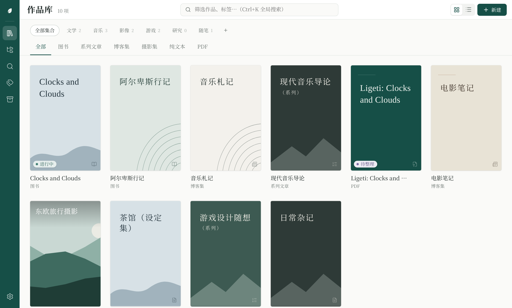
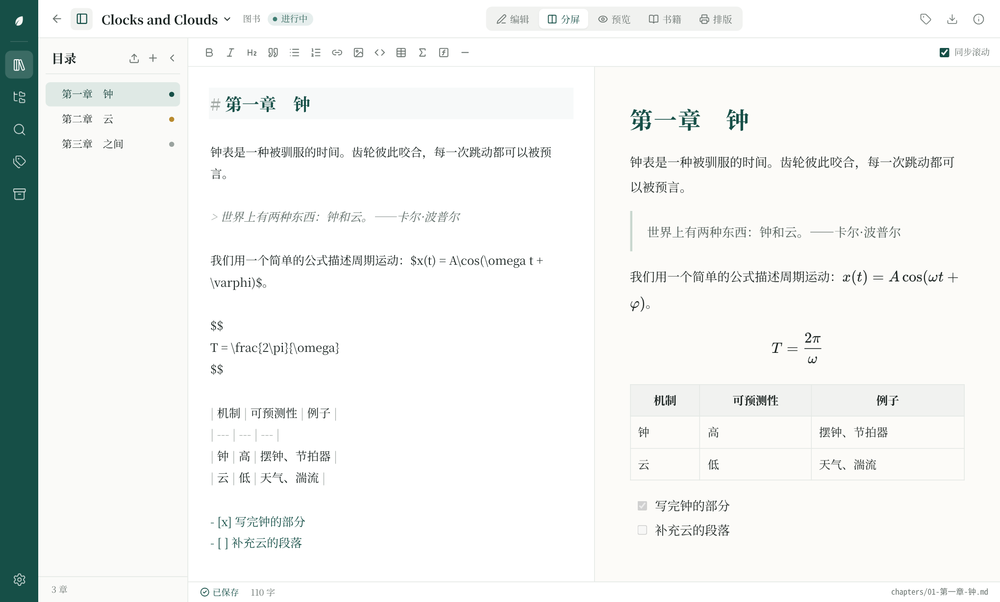
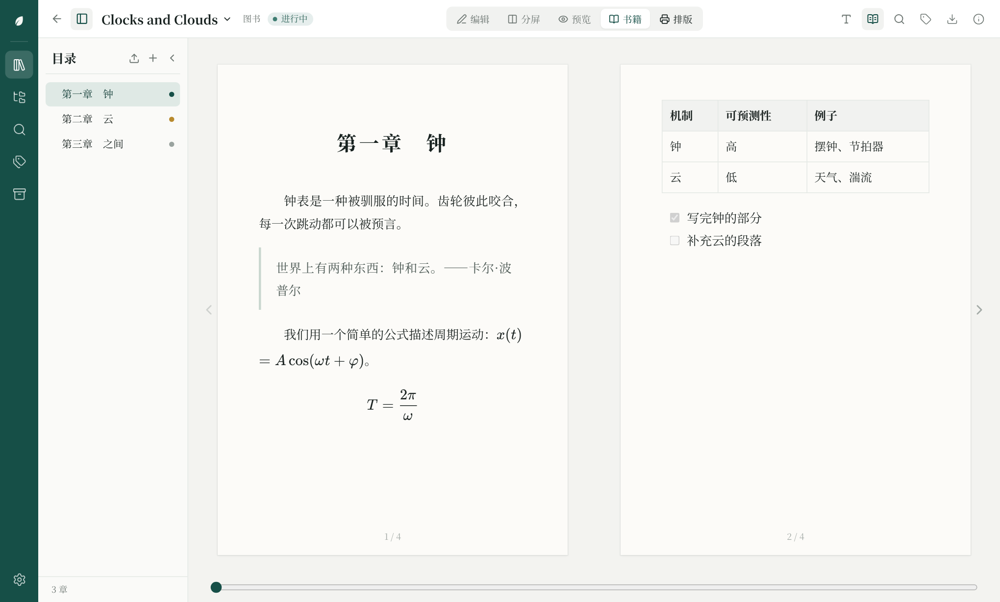
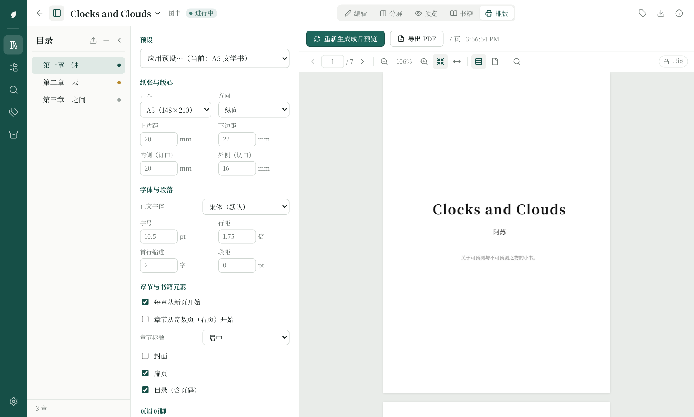
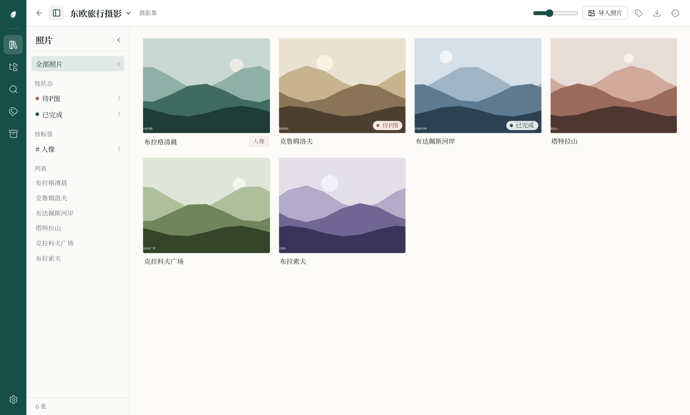

<div align="center">


# Leafor

**A local-first portfolio library and writing studio**<br>
**本地优先的作品档案馆与创作工作台**

[English](#english) · [简体中文](#简体中文)



</div>

---

<a id="english"></a>

## English

Leafor is a desktop app for organizing and creating your own work — books, blogs, article series, photo albums, plain documents and archived PDFs — in one calm, book-like workspace. Think of it as a Markdown editor combined with a personal portfolio library. Everything runs locally: no account, no cloud, no telemetry.

Your work is stored as ordinary files in a folder you choose — Markdown for text, original images and PDFs, and plain JSON for metadata — so it stays readable even without Leafor.

### Features

- **Library & collections** — group any mix of items into collections; flat cover grid or list view; drag to reorder; tags and statuses on every item.
- **Markdown editor** — CodeMirror 6 with edit / split / preview modes, GFM tables and task lists, footnotes, syntax highlighting and **LaTeX math** (KaTeX).
- **Books** — chapters as separate `.md` files, drag-to-reorder catalog, flat single/double-page **book reading mode**.
- **Print layout & PDF** — per-book layout profile (paper size, margins, Song typeface, line spacing, running heads, page numbers, table of contents, title page); the PDF preview is byte-identical to the exported file.
- **Blogs** — publish dates, drafts, year/month archive, tag filters, offline HTML archive export.
- **Article series** — your own reading order, volumes/groups, previous/next navigation, continuous reading.
- **Photo albums** — import with EXIF, reorder, captions, full-screen viewer, statuses like "needs retouching".
- **Read-only PDF archive** — imported PDFs are never modified (SHA-256 verified); bookmarks, thumbnails, search and notes stored separately.
- **Search** — full-text across all content, with status / tag / type / collection filters (Ctrl+K).
- **Import / export** — Markdown, Word (DOCX), HTML, PDF; imports always copy, sources are never touched.
- **Safe by design** — atomic saves, conflict detection for external edits, crash-recovery drafts, in-library recycle bin.

### Screenshots

| Writing (split view) | Book reading mode |
| --- | --- |
|  |  |
| **Print layout & PDF preview** | **Photo album** |
|  |  |

### Getting Leafor

**Windows (portable):** build it with the script below, then run `release\Leafor\Leafor.exe` (keep `WebView2Loader.dll` next to it). Requires the Microsoft Edge WebView2 runtime, included with Windows 10/11. Leafor stores its own settings, search index and cache in `LeaforData\` beside the executable.

**Build on Windows:** double-click `scripts\windows\build-windows.bat`. It uses your Node.js (≥ 20.19), installs Rust into `D:\D\leafor-toolchain` without touching `PATH`, needs Visual Studio's C++ build tools, runs the tests and produces the portable build.

**Cross-compile from Linux:** `scripts/cross-build-windows.sh` (Ubuntu 24.04 with `mingw-w64`, `rustc-1.89`, `rust-1.89-src`).

### Documentation

- User guide: [English (PDF)](docs/Leafor-User-Guide.pdf) · [Markdown](docs/Leafor-User-Guide.md) · [繁體中文（臺灣）PDF](docs/Leafor-User-Guide.zh-TW.pdf) · [Markdown](docs/Leafor-User-Guide.zh-TW.md)
- [Product specification](docs/product-spec.md) · [Technical design](docs/technical-design.md)

### Development

Requires Node.js ≥ 20.19, pnpm, and Rust (plus the [Tauri prerequisites](https://v2.tauri.app/start/prerequisites/) for your OS).

```bash
pnpm install
pnpm dev            # browser preview with an in-memory sample library
pnpm tauri dev      # desktop app in development mode
pnpm test           # unit + integration tests (Vitest)
pnpm typecheck
pnpm tauri build    # release build
cd src-tauri && cargo test
```

End-to-end scripts live in `tests/e2e/` (browser via Playwright, desktop via `tauri-driver`).

**Stack:** Tauri 2 · React 19 · TypeScript · Vite · CodeMirror 6 · unified/remark/rehype · KaTeX · PDF.js · pdf-lib · mammoth · docx · SQLite (rusqlite) · Zustand · Zod.

```text
src/domain/      pure TS models, schemas and rules (ordering, blog timeline, series navigation)
src/services/    repository, import/export, print layout, search index, thumbnails
src/adapters/    Tauri (scoped Rust commands) and in-memory (tests & browser preview)
src/features/    library, collections, book, blog, series, photos, document, PDF, search, settings
src-tauri/src/   path scoping & atomic writes, dialogs, import/export, SQLite index cache
```

### Library folder layout

```text
MyLibrary/
├── .leafor/            workspace.json, cache/, recovery/, trash/
└── collections/<name>--c_…/items/<name>--i_…/
    ├── item.json       metadata (order, tags, status…)
    ├── chapters/ posts/ articles/ photos/   your content
    ├── assets/         images
    ├── layouts/        print layout profile
    └── originals/      imported originals (DOCX, PDF)
```

Copy the folder to back it up or move it — all paths inside are relative.

---

<a id="简体中文"></a>

## 简体中文

Leafor 是一款本地作品管理和编辑软件，可以把自己写的文章、书籍、博客、摄影集等整理成作品集。支持 Markdown 编辑、LaTeX 公式、PDF 阅读和多格式导出，有点像 Obsidian 加上一个个人作品图书馆，完全本地运行，不依赖云端。

作品以普通文件保存在你选择的文件夹中：文字是 Markdown，图片和 PDF 保持原样，元数据是纯文本 JSON。没有账户、没有云端、没有遥测；即使不再使用 Leafor，作品依然可以用常规工具打开。

### 功能

- **作品库与集合**：集合内可混合放入任意类型的作品；平面封面网格或列表视图；拖动排序；作品与内容单元都可设置标签和状态。
- **Markdown 编辑器**：基于 CodeMirror 6，支持编辑 / 分屏 / 预览，GFM 表格与任务列表、脚注、代码高亮和 **LaTeX 公式**（KaTeX）。
- **图书**：每章是独立的 `.md` 文件；目录可拖动排序；平面单页 / 双页**书籍阅读模式**。
- **出版排版与 PDF**：每本书独立的排版配置（开本、版心、宋体、行距、页眉页脚、页码、目录、扉页）；PDF 成品预览与导出文件逐字节一致。
- **博客集**：发布日期、草稿区、按年月归档、标签筛选，可导出离线 HTML 归档。
- **系列文章**：按自定义顺序阅读，支持分卷 / 分组、上一篇 / 下一篇导航和连续阅读。
- **摄影集**：导入时读取 EXIF，排序、说明、全屏浏览，用“待P图”等状态管理修图进度。
- **只读 PDF 归档**：导入的 PDF 永不修改（SHA-256 校验）；书签、缩略图、文字搜索，笔记单独保存。
- **搜索**：跨作品全文搜索，可按状态 / 标签 / 类型 / 集合筛选（Ctrl+K）。
- **导入导出**：Markdown、Word（DOCX）、HTML、PDF；导入一律复制，原文件不会被改动。
- **安全可靠**：原子写入、外部修改冲突检测、异常退出草稿恢复、作品库内回收站。

### 截图

| 分屏写作 | 书籍阅读模式 |
| --- | --- |
|  |  |
| **出版排版与 PDF 预览** | **摄影集** |
|  |  |

### 获取与构建

**Windows 便携版：** 用下面的脚本构建后运行 `release\Leafor\Leafor.exe`（`WebView2Loader.dll` 需放在同一目录）。需要 Microsoft Edge WebView2 运行时（Windows 10/11 自带）。Leafor 自身的设置、搜索索引和缓存保存在 exe 旁边的 `LeaforData\` 中。

**在 Windows 上构建：** 双击 `scripts\windows\build-windows.bat`。脚本使用已安装的 Node.js（≥ 20.19），把 Rust 安装到 `D:\D\leafor-toolchain` 且不修改 `PATH`，需要 Visual Studio 的 C++ 生成工具，会运行测试并生成便携版。

**在 Linux 上交叉编译：** `scripts/cross-build-windows.sh`（Ubuntu 24.04，需 `mingw-w64`、`rustc-1.89`、`rust-1.89-src`）。

### 文档

- 使用指南：[English（PDF）](docs/Leafor-User-Guide.pdf) · [Markdown](docs/Leafor-User-Guide.md) · [繁體中文（臺灣）PDF](docs/Leafor-User-Guide.zh-TW.pdf) · [Markdown](docs/Leafor-User-Guide.zh-TW.md)
- [产品规格说明书](docs/product-spec.md) · [技术设计文档](docs/technical-design.md)

### 开发

需要 Node.js ≥ 20.19、pnpm 与 Rust（以及对应系统的 [Tauri 前置依赖](https://v2.tauri.app/start/prerequisites/)）。

```bash
pnpm install
pnpm dev            # 浏览器预览（内存后端 + 示例作品库）
pnpm tauri dev      # 桌面开发模式
pnpm test           # 单元与集成测试（Vitest）
pnpm typecheck
pnpm tauri build    # 发布构建
cd src-tauri && cargo test
```

端到端测试脚本位于 `tests/e2e/`（浏览器端用 Playwright，桌面端用 `tauri-driver`）。

**技术栈：** Tauri 2 · React 19 · TypeScript · Vite · CodeMirror 6 · unified/remark/rehype · KaTeX · PDF.js · pdf-lib · mammoth · docx · SQLite（rusqlite）· Zustand · Zod。

### 作品库目录结构

```text
我的作品库/
├── .leafor/            workspace.json、cache/、recovery/、trash/
└── collections/<名称>--c_…/items/<名称>--i_…/
    ├── item.json       元数据（顺序、标签、状态等）
    ├── chapters/ posts/ articles/ photos/   作品内容
    ├── assets/         图片
    ├── layouts/        排版配置
    └── originals/      导入的原始文件（DOCX、PDF）
```

备份或迁移时直接复制整个文件夹即可，内部全部使用相对路径。
