# Leafor User Guide

*Version 0.1 · A local-first studio for writing, organizing and archiving your work*

Leafor keeps everything you create — books, blog posts, article series, photo albums, plain documents and archived PDFs — in an ordinary folder on your computer. There is no account, no cloud and no telemetry. Text is saved as Markdown, photos and PDFs stay as normal files, and metadata is plain JSON, so your work remains readable even without Leafor.

The interface is in Chinese; this guide quotes the on-screen labels (for example **新建**) so you can find them.

---

## 1. Getting started

### 1.1 Running Leafor

Open `release\Leafor\` and double-click **Leafor.exe**. Keep `WebView2Loader.dll` in the same folder. Leafor needs the Microsoft Edge WebView2 runtime, which Windows 10/11 already includes.

Leafor is portable: its own settings, the list of recent libraries, the search index and its browser cache are stored in a `LeaforData` folder next to `Leafor.exe`. Nothing is written to the system drive.

### 1.2 The welcome screen

The first time you start Leafor (or after **设置 → 切换作品库**), you choose a library (作品库):

| Button | What it does |
| --- | --- |
| **新建作品库** | Pick a location, give the library a name; Leafor creates a folder with that name. |
| **打开作品库** | Open an existing Leafor library. If the folder you pick isn't one yet, Leafor offers to initialize it (existing files are not touched). |
| **创建示例作品库** | Creates a library filled with examples of every item type — the quickest way to explore. |
| **最近打开** | Reopen a recent library. The ✕ only removes it from the list; files are not deleted. |

Leafor reopens your last library automatically on the next start.

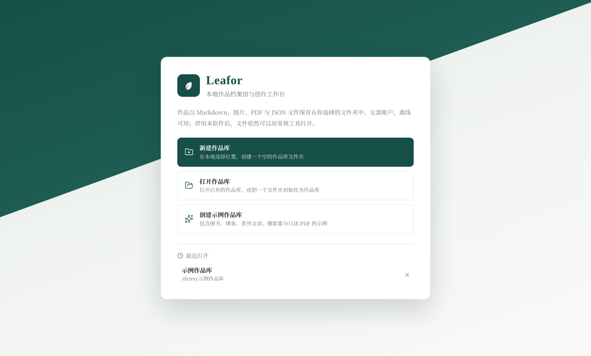
*The welcome screen*

---

## 2. The interface at a glance

The narrow green bar on the left is the global navigation:

| Icon | Page | Purpose |
| --- | --- | --- |
| Books | **作品库** (Library) | All your items as covers or a list. |
| Tree | **集合** (Collections) | Create, rename, reorder and delete collections. |
| Magnifier | **搜索与筛选** (Search) | Search titles, text and tags across everything. Shortcut **Ctrl+K**. |
| Tag | **标签与状态** (Tags & statuses) | Manage your tag and status vocabularies. |
| Box | **归档与回收站** (Archive & recycle bin) | Archived items and deleted things you can restore. |
| Gear (bottom) | **设置** (Settings) | Library info, editor options, fonts, index & cache, switch library. |

Inside an item, the top bar shows **←** (back to the library), the **◫** button that shows/hides the side panel (目录, the catalog), the item title (click it for a menu), the view modes in the middle, and on the right: tags/status, export (↓) and properties (ⓘ).

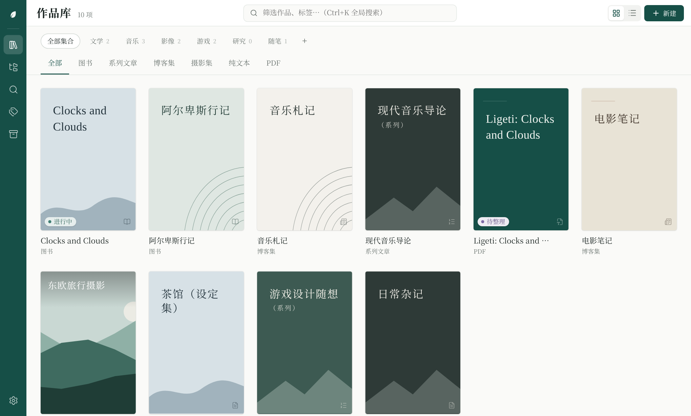
*The library: icon bar, collection chips, type tabs and covers*

---

## 3. Collections and items

### 3.1 Concepts

- A **collection** (集合) is a group such as "文学作品" or "摄影作品". It can mix any item types.
- An **item** (单品) is one work: a book, an article series, a blog, a photo album, a plain-text document or an archived PDF.
- An item's parts — chapters, posts, articles, photos — are called **content units**.

### 3.2 Creating things

Click **＋ 新建** in the Library's top-right corner:

- **新建集合** — a new collection.
- **图书 / 系列文章 / 博客集 / 摄影集 / 纯文本** — a new item. If a collection is selected in the chip row, it goes there; otherwise Leafor asks which collection to use.
- **导入 Markdown / Word（DOCX）/ 照片 / PDF（只读）** — see section 10.

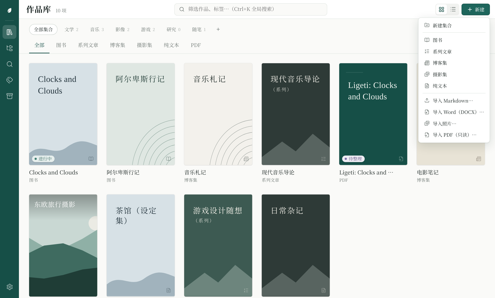
*The 新建 menu: create collections and items, or import files*

You can also create a collection from the **＋** at the end of the collection chips.

### 3.3 Browsing the library

- **Collection chips** (全部集合, 文学, …) filter by collection. **Type tabs** (全部, 图书, 系列文章, …) filter by type.
- The search box at the top filters by title, summary, author and tag. Press **Enter** to run a full search.
- Switch between **grid** and **list** view with the two buttons next to **新建**.
- **Reorder items:** select a single collection (and no type filter), then drag covers.
- **Multi-select:** **Ctrl+click** covers, then use **批量设置状态与标签** in the bar that appears.

### 3.4 The item menu

Hover a cover and click **⋯**, or right-click it:

| Menu item | Effect |
| --- | --- |
| 打开 | Open the item. |
| 重命名 | Change the title (the folder name on disk stays stable). |
| 属性与封面 | Title, author, summary, notes, and a cover image (**选择封面** / **使用默认封面**). |
| 状态与标签 | Set status and tags. |
| 移动到集合… | Move the item to another collection. |
| 在文件管理器中显示 | Open the item's folder in Explorer. |
| 归档 | Hide it from the library without deleting (find it under 归档与回收站). |
| 移到回收站 | Delete (recoverable, see section 12). |

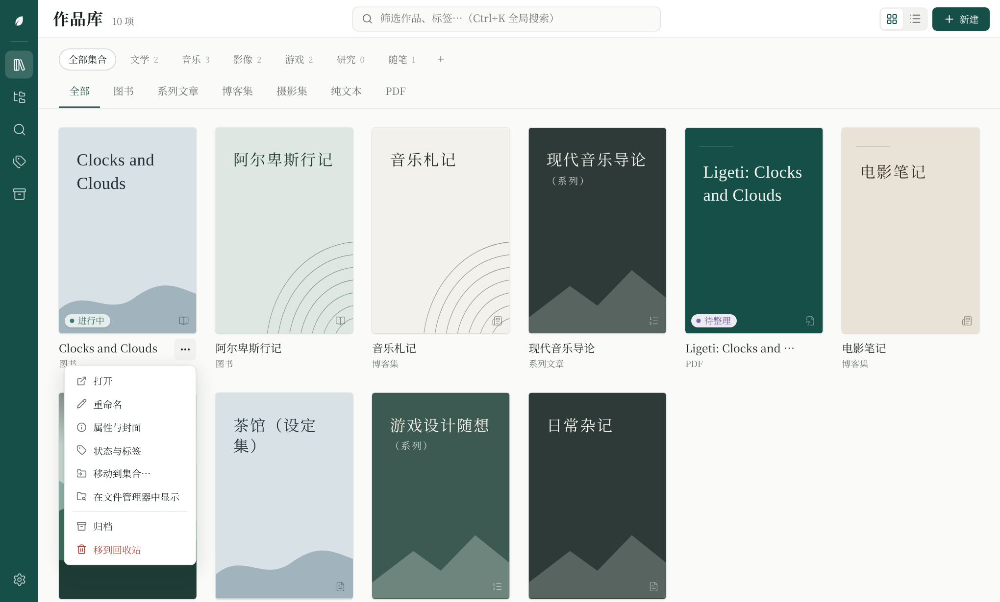
*The item menu (⋯ on a cover, or right-click)*

Items without a cover image get a flat, generated typographic cover. Photo albums use their first photo.

---

## 4. Writing in Markdown

Books, blog posts, series articles and plain documents all share the same editor.

### 4.1 View modes

| Mode | Description |
| --- | --- |
| **编辑** (Edit) | Markdown source only. |
| **分屏** (Split) | Source on the left, rendered preview on the right. Tick **同步滚动** to scroll them together. |
| **预览** (Preview) | Rendered reading view only. |

Switching modes never changes your file.

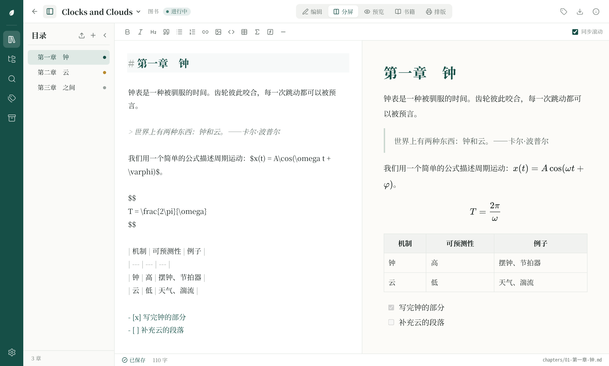
*Split mode: Markdown source on the left, live preview on the right; the catalog (目录) on the far left*

### 4.2 Toolbar and shortcuts

The toolbar inserts: bold, italic, heading, quote, bullet / numbered list, link, **image**, code block, table, inline formula, block formula and a horizontal rule.

| Shortcut | Action |
| --- | --- |
| Ctrl+S | Save now |
| Ctrl+B / Ctrl+I | Bold / italic |
| Ctrl+F | Find (and replace) in the editor |
| Ctrl+Z / Ctrl+Y | Undo / redo |
| Tab | Indent |

### 4.3 Supported Markdown

Standard Markdown plus tables, task lists (`- [x]`), strikethrough, footnotes (`[^1]`), code blocks with syntax highlighting, and **math**:

```markdown
Inline: $e^{i\pi} + 1 = 0$

Block:
$$
\int_0^1 x^2\,dx = \frac{1}{3}
$$
```

Unknown syntax is kept exactly as you typed it.

### 4.4 Images

Click the **image** button, pick files — Leafor copies them into the item's `assets/` folder and inserts a relative link. Your original image files are never moved or changed. Images from the internet (`https://…`) are not loaded automatically, for privacy.

### 4.5 Saving, conflicts and recovery

- **Autosave:** about one second after you stop typing, the file is written safely (a temporary file, then an atomic replace). The status bar shows **已保存** (saved), **未保存** (unsaved) or **保存中…** (saving).
- **External edits:** if you edit a file in another program while Leafor is open, Leafor reloads it when you come back to the window. If you *also* have unsaved changes, a **文件冲突** dialog shows both versions. You can save your version as a copy, discard it, or overwrite. Leafor never overwrites silently.
- **Crash recovery:** unsaved text is kept as a draft. After an unexpected exit, a yellow banner offers **恢复** (restore) or **丢弃** (discard).

---

## 5. Books (图书)

### 5.1 The catalog (目录)

The left panel lists the chapters. If it's hidden, click **◫** next to the back arrow.

- **＋** creates a chapter; **↑** imports Markdown files as chapters.
- **Drag** chapters to reorder them; a line shows where they'll land.
- **Right-click** a chapter to rename, set status/tags, duplicate, export it, or delete it.
- Drag the panel's right edge to resize it (double-click the edge to reset).

Each chapter is a separate `.md` file in the book's `chapters/` folder.

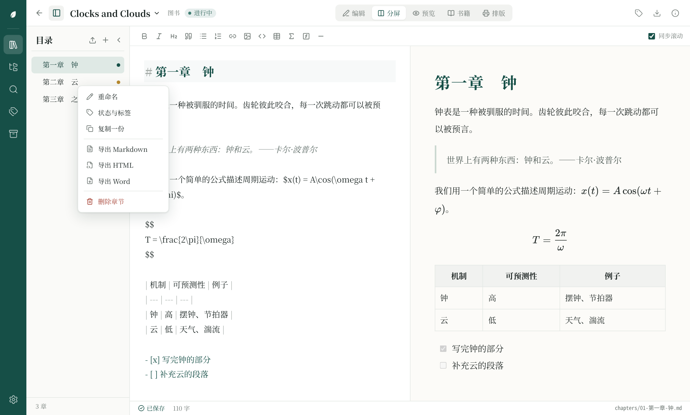
*Right-click a chapter for its menu*

### 5.2 Book reading mode (书籍)

Shows the whole book as flat pages, single or double-page.

| Control | Action |
| --- | --- |
| ← → / Page Up, Page Down / Space | Turn pages |
| Home / End | First / last page |
| Click a chapter in the catalog | Jump to it |
| **Aa** button | Font size, line spacing, paper colour |
| Book button | Toggle single / double page |
| Search button | Find text in the whole book |
| Slider at the bottom | Jump anywhere |

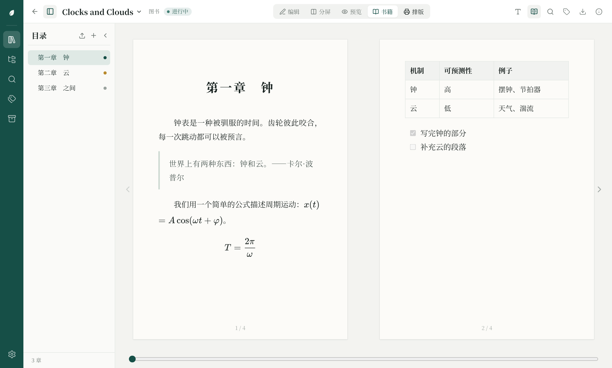
*Book reading mode with double pages*

### 5.3 Layout and PDF (排版)

Turn a book into a print-ready PDF:

1. Choose a **预设** (A5 文学书, 32 开小说, B5 讲义, A4 文稿) or adjust settings yourself:
   - **纸张与版心** — page size (A4 / B5 / A5 / 32K / custom), orientation, margins (inner / outer for binding).
   - **字体与段落** — font (Song is the default), size, line spacing, first-line indent, paragraph spacing.
   - **章节与书籍元素** — chapters start on a new / odd page, title alignment, cover, title page, table of contents with page numbers.
   - **页眉页脚** — page numbers (centred or outer), chapter title in the header, mirrored left/right pages, custom header/footer text.
   - **输出** — resolution: 150 dpi (fast), 200 dpi (screen), 300 dpi (print).
2. Click **生成成品预览** and check the result page by page.
3. To change something, edit the chapters or the settings and regenerate. The PDF itself is never edited.
4. Click **导出 PDF**. The exported file is exactly the preview you saw.

Settings are saved with the book (`layouts/print.json`) via **保存配置**. Note: the PDF pages are high-resolution images, so text in the PDF can't be selected.

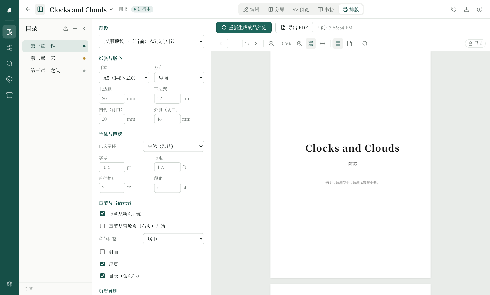
*Layout settings on the left, the generated PDF preview on the right*

---

## 6. Blogs (博客集)

- The **博客首页** shows posts newest-first, with a separate **草稿** (drafts) section.
- The side panel groups posts by **year → month**. Click a month to filter; click a tag chip to filter by tag; use the small search box to search this blog.
- A post with **no publish date is a draft**. In the bar above a post:
  - set the **date**, or click **今天发布** (publish today) / **转为草稿** (back to draft);
  - write a one-line **摘要** (excerpt) shown on the blog home;
  - set a **slug** used for exported file names.
- Status (e.g. 待校对) and publish date are independent.
- Posts show **newer / older** links at the bottom in reading mode.
- On the blog home, tick posts to change their status/tags in bulk.

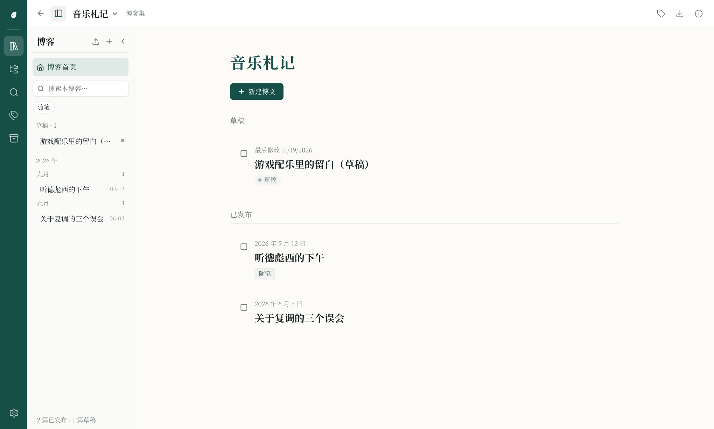
*Blog home: drafts, posts by date, and the year/month archive*

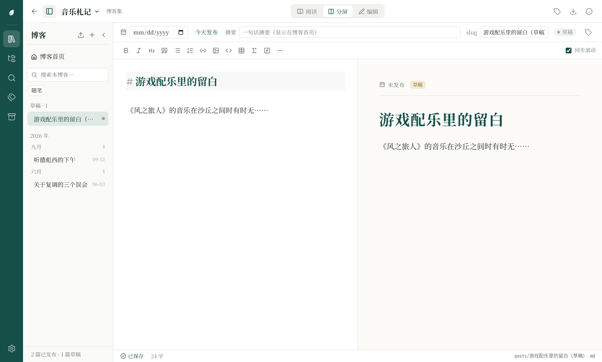
*Editing a post: publish date, excerpt and slug above the editor*

---

## 7. Article series (系列文章)

- The order is **your order**, not creation date — drag articles in the **系列目录** panel.
- **Groups** (volumes / parts): click the folder-plus icon to add one; drag articles into it. Right-click a group to rename, move it up/down, or delete it (its articles become ungrouped, not deleted).
- Reading view shows the series name, group and **第 n / N 篇**, plus **上一篇 / 下一篇** links.
- **连续阅读** shows the whole series in one scroll.
- The series home has **从第一篇开始阅读** (start from the first article).

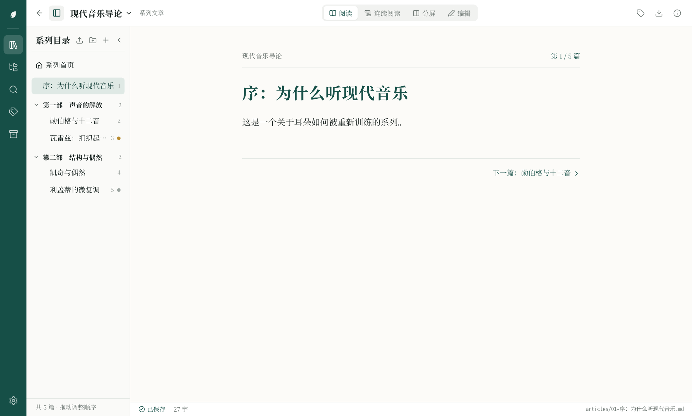
*Reading a series article: position, groups in the catalog, previous/next links*

---

## 8. Photo albums (摄影集)

- **导入照片** copies photos into the album (originals untouched). Leafor reads size and camera EXIF data.
- **Drag** tiles to reorder; use the slider to change tile size.
- **Click** a photo to open the viewer: ← → to browse, **F** for full screen, **I** for the info panel, **Esc** to close.
- In the info panel you can edit the title, caption, notes, status and tags, and see EXIF details.
- Use a status such as **待P图** (needs retouching) to track editing. Leafor has no image editor: use **用系统程序打开** to edit in your usual program, then **替换为修图后的版本** to swap in the new file (the old one goes to the recycle bin).
- The side panel filters by status or tag. **Ctrl+click** tiles to select several, then change marks in bulk or move them to the recycle bin.
- Right-click a photo → **设为封面** to make it the album cover.

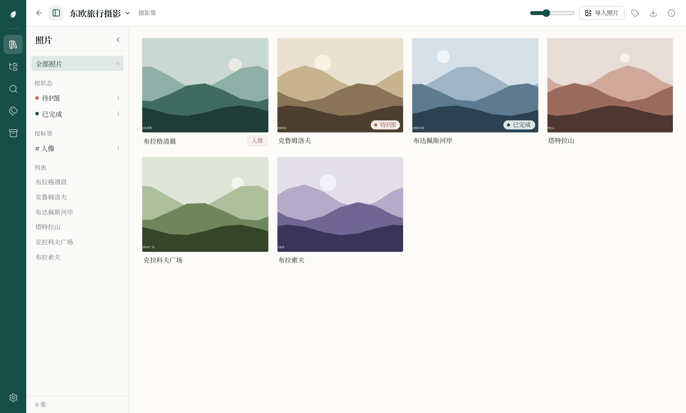
*A photo album with status badges and filters*

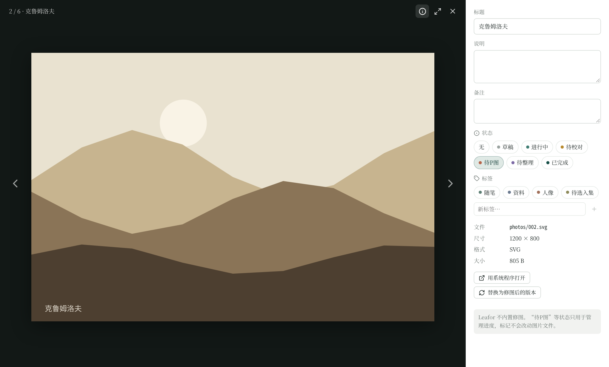
*The photo viewer with the info panel*

---

## 9. Archived PDFs (PDF, read-only)

Imported PDFs are archival objects: **Leafor never changes them.**

- Read with page navigation, zoom (fit page / fit width / %), continuous or single-page view (← → in single-page mode), and text search (**Ctrl+F**, works when the PDF has a text layer).
- The side panel has three tabs: **bookmarks** (the PDF's own outline), **thumbnails**, and **notes** (stored by Leafor, not inside the PDF).
- Tags, status, notes and your last reading position are saved in Leafor's metadata.
- **🛡 Verify** checks the file's SHA-256 fingerprint against the one recorded at import.
- **Open externally** opens it in your default PDF reader; **另存原始 PDF** saves an exact copy elsewhere.
- Encrypted PDFs ask for a password, which is used only for viewing and never saved.

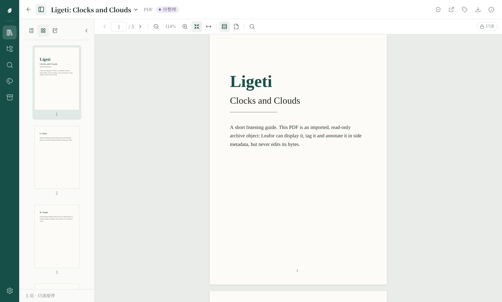
*An archived PDF: read-only viewer with bookmarks, thumbnails and notes*

---

## 10. Plain documents (纯文本)

A single Markdown document with an **大纲** (outline) panel built from its headings. Click a heading to jump to it.

---

## 11. Tags, statuses and search

### 11.1 Tags vs. statuses

- **Status (状态)** = progress. One per object: 草稿, 进行中, 待校对, 待P图, 待整理, 已完成 — or your own.
- **Tags (标签)** = free classification, any number per object: 随笔, 资料, 人像, 待选入集 …
- An item and each of its chapters/photos/posts have **independent** marks.

Set them with the **tag button** in an item's top bar, via right-click on any chapter/post/photo, or in batch after multi-selecting. In the popup you can also type a **new tag** and press Enter.

On the **标签与状态** page you can rename, recolour, reorder and delete them; the usage count links to a search of everything that uses it.

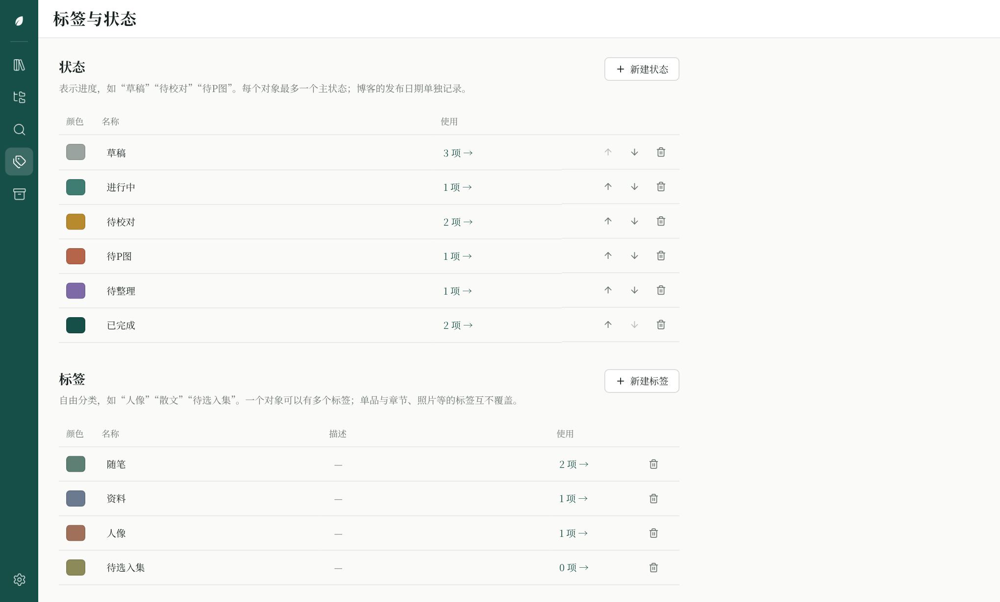
*The 标签与状态 page*

### 11.2 Search (Ctrl+K)

Search titles, full text of all Markdown, captions, notes and tag names (Chinese substring matching). Filter by status, tag, type, collection, and whether to show items, content units, or both. Example: choose status **待P图** to list every photo still waiting to be retouched, across all albums.

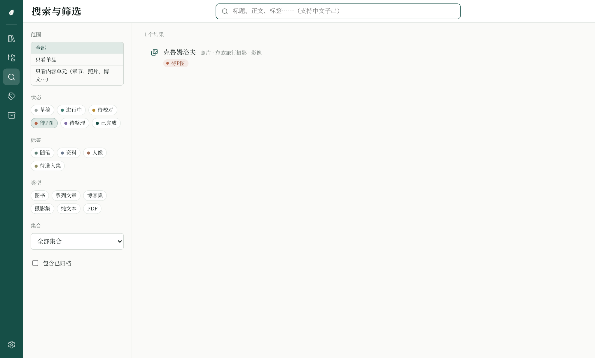
*Search filtered by status 待P图*

---

## 12. Importing and exporting

### 12.1 Import

| Source | How | Result |
| --- | --- | --- |
| Markdown | 新建 → 导入 Markdown | One plain document per file, or several files merged into one book (one chapter each). Relative images are copied in. |
| Markdown into an item | ↑ button in a book / blog / series panel | New chapters / posts / articles. |
| Word (.docx) | 新建 → 导入 Word | Choose to split by heading level into chapters (rename them in the dialog) or keep as one document. Images go to `assets/`; the original .docx is kept in `originals/`. Formulas and comments may not convert. |
| Photos | 新建 → 导入照片, or 导入照片 in an album | Copied into the album. |
| PDF | 新建 → 导入 PDF（只读） | Copied unchanged into `originals/`, fingerprinted. |

All imports **copy**; your source files are never modified.

### 12.2 Export (↓ button in the top bar, or right-click a unit)

| Item | Formats |
| --- | --- |
| Book | Markdown (per chapter or merged), HTML, Word, PDF (via 排版) |
| Blog | Single post (MD / HTML / Word); whole blog as an offline HTML archive (with or without drafts); Markdown |
| Series | Single article; merged Markdown; HTML site with contents and previous/next links; single-page HTML; Word; PDF |
| Document | Markdown, HTML, Word, PDF |
| Photo album | Original files (all or selected) |
| PDF | Exact copy of the original |

HTML exports work offline: images and math fonts are included in the export folder. In Word, formulas are kept as LaTeX text.

---

## 13. Deleting, archiving and restoring

- **Archive (归档):** hides an item from the library; it stays in place. Undo with **取消归档**.
- **Move to recycle bin (移到回收站):** items, collections, chapters/posts/articles and photos are moved into the library's `.leafor/trash` folder.
- On **归档与回收站**: **恢复** restores; **永久删除** permanently deletes (the only action that really erases files).
- **Deleting a collection:** go to **集合**, click **⋯** on its card → **移到回收站**. Its items go with it.

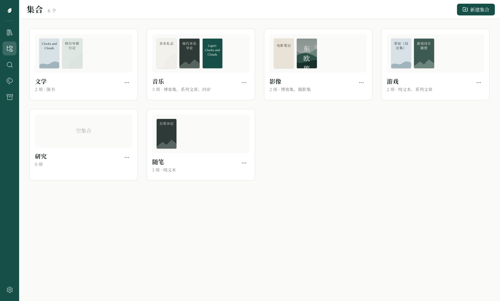
*The Collections page*

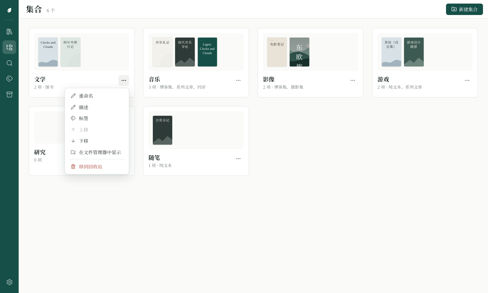
*A collection's ⋯ menu — 移到回收站 deletes it*

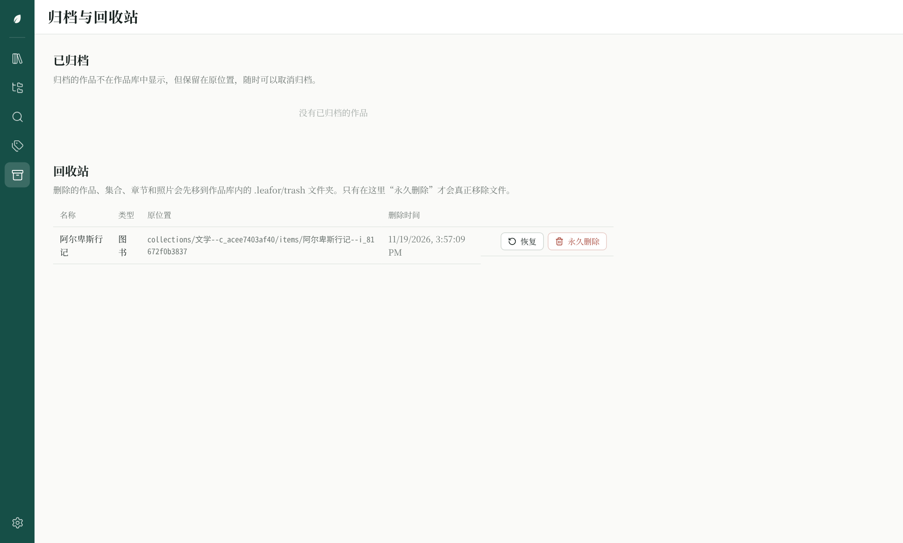
*归档与回收站: restore or permanently delete*

---

## 14. Where your files live

```text
MyLibrary/
├── .leafor/
│   ├── workspace.json      tags, statuses, collection order, settings
│   ├── cache/              thumbnails & PDF previews (safe to delete)
│   ├── recovery/           unsaved drafts
│   └── trash/              recycle bin
└── collections/
    └── 文学--c_…/
        ├── collection.json
        └── items/
            └── 我的书--i_…/
                ├── item.json        title, chapter order, marks…
                ├── chapters/*.md    your text
                ├── assets/          images
                ├── layouts/         PDF layout settings
                └── originals/       imported originals (DOCX, PDF)
```

- **Back up / move** a library by copying the whole folder. Paths inside are relative, so it works anywhere.
- You can edit the `.md` files with any editor; Leafor picks up the changes.
- The search index and thumbnails are only caches. **设置 → 重建搜索索引 / 清除缩略图与预览缓存** rebuilds them; your work is never affected.

---

## 15. Troubleshooting

| Problem | Solution |
| --- | --- |
| The chapter list (目录) is missing | Click **◫** next to **←**. It auto-hides on narrow windows. |
| I can't find something I deleted | **归档与回收站** — check both *已归档* and *回收站*. |
| Text doesn't use Song font | **设置 → 字体** shows which fonts were detected. Install SimSun / Source Han Serif and restart. |
| "文件冲突" dialog appeared | The file changed outside Leafor while you had unsaved edits. Pick a version; "save mine as a copy" is the safest. |
| A yellow recovery banner appears | Leafor found unsaved text from last time; choose **恢复** or **丢弃**. |
| Search misses recent changes | **设置 → 重建搜索索引**. |
| Some files were skipped when loading | **设置** lists invalid metadata files; they were left untouched on disk. |
| Photos in HEIC/TIFF don't show | The viewer can't display these formats; use **用系统程序打开**. |
| Leafor won't start | Make sure `WebView2Loader.dll` is next to `Leafor.exe` and the WebView2 runtime is installed. |

---

## 16. Keyboard shortcuts

| Where | Keys | Action |
| --- | --- | --- |
| Anywhere | Ctrl+K | Search |
| Editor | Ctrl+S, Ctrl+B, Ctrl+I, Ctrl+F, Ctrl+Z / Ctrl+Y, Tab | Save, bold, italic, find, undo/redo, indent |
| Book reader | ← →, Page Up/Down, Space, Home, End | Turn pages, first/last page |
| Photo viewer | ← →, F, I, Esc | Browse, full screen, info, close |
| PDF reader | Ctrl+F; ← → in single-page mode | Search, turn pages |
| Dialogs & menus | Enter, Esc | Confirm, close |
