# Leafor 使用指南

*版本 0.1 · 本機優先的寫作、整理與典藏工作室*

Leafor 會把你創作的一切——書籍、部落格文章、系列文章、攝影集、純文字文件與典藏的 PDF——都存放在你電腦上的一般資料夾裡。不需要帳號、不連雲端、不蒐集使用資料。文字以 Markdown 儲存，照片與 PDF 維持原本的檔案，詮釋資料則是純文字 JSON，因此即使不使用 Leafor，你的作品依然可以用其他軟體開啟。

> **關於介面文字：** Leafor 目前的介面以簡體中文顯示。本指南引用畫面上的按鈕與選單名稱時（例如 **新建**），會保留畫面上的原字形並以粗體標示，方便你對照尋找；括號內附上臺灣慣用說法。

---

## 1. 開始使用

### 1.1 執行 Leafor

開啟 `release\Leafor\` 資料夾，按兩下 **Leafor.exe**。請讓 `WebView2Loader.dll` 與它放在同一個資料夾。Leafor 需要 Microsoft Edge WebView2 執行階段，Windows 10/11 已內建。

Leafor 是免安裝的可攜式程式：它自己的設定、最近開啟的作品庫清單、搜尋索引與瀏覽器快取，都存放在 `Leafor.exe` 旁邊的 `LeaforData` 資料夾，不會寫入系統磁碟。

### 1.2 歡迎畫面

第一次啟動 Leafor（或在 **设置 → 切换作品库** 之後），需要選擇一個作品庫：

| 按鈕 | 功能 |
| --- | --- |
| **新建作品库**（新增作品庫） | 選擇存放位置並命名，Leafor 會建立同名資料夾。 |
| **打开作品库**（開啟作品庫） | 開啟現有的 Leafor 作品庫。若所選資料夾還不是作品庫，Leafor 會詢問是否初始化（既有檔案不會被更動）。 |
| **创建示例作品库**（建立範例作品庫） | 建立一個包含各種作品類型範例的作品庫，是最快上手的方式。 |
| **最近打开**（最近開啟） | 重新開啟最近使用的作品庫。✕ 只會從清單移除，不會刪除檔案。 |

下次啟動時，Leafor 會自動開啟你上次使用的作品庫。

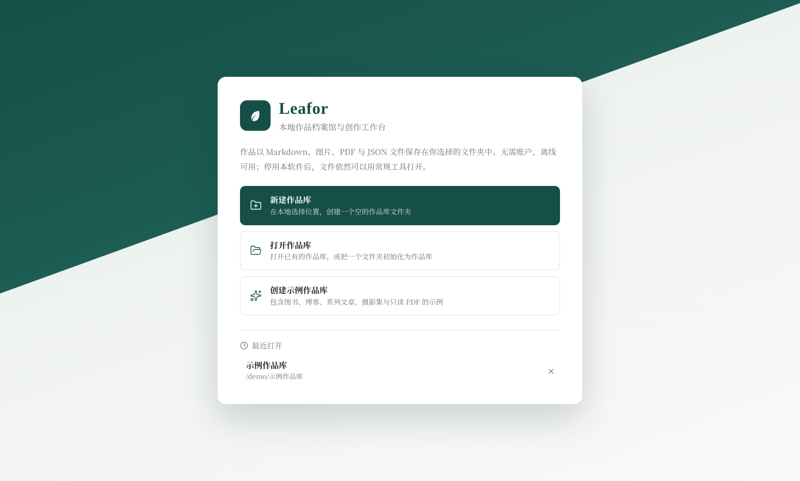
*歡迎畫面*

---

## 2. 介面總覽

左側窄窄的綠色欄是全域導覽列：

| 圖示 | 頁面 | 用途 |
| --- | --- | --- |
| 書本 | **作品库**（作品庫） | 以封面或清單瀏覽所有作品。 |
| 樹狀 | **集合** | 建立、重新命名、調整順序與刪除集合。 |
| 放大鏡 | **搜索与筛选**（搜尋與篩選） | 跨所有內容搜尋標題、內文與標籤。快速鍵 **Ctrl+K**。 |
| 標籤 | **标签与状态**（標籤與狀態） | 管理你的標籤與狀態詞彙。 |
| 箱子 | **归档与回收站**（封存與資源回收筒） | 已封存的作品，以及可以還原的已刪除項目。 |
| 齒輪（底部） | **设置**（設定） | 作品庫資訊、編輯器選項、字型、索引與快取、切換作品庫。 |

進入某件作品後，頂端列依序是：**←**（返回作品庫）、**◫** 按鈕（顯示／隱藏側邊的 **目录**，也就是目錄）、作品標題（點一下會出現選單）、中間的檢視模式，以及右側的標籤／狀態、匯出（↓）與屬性（ⓘ）。

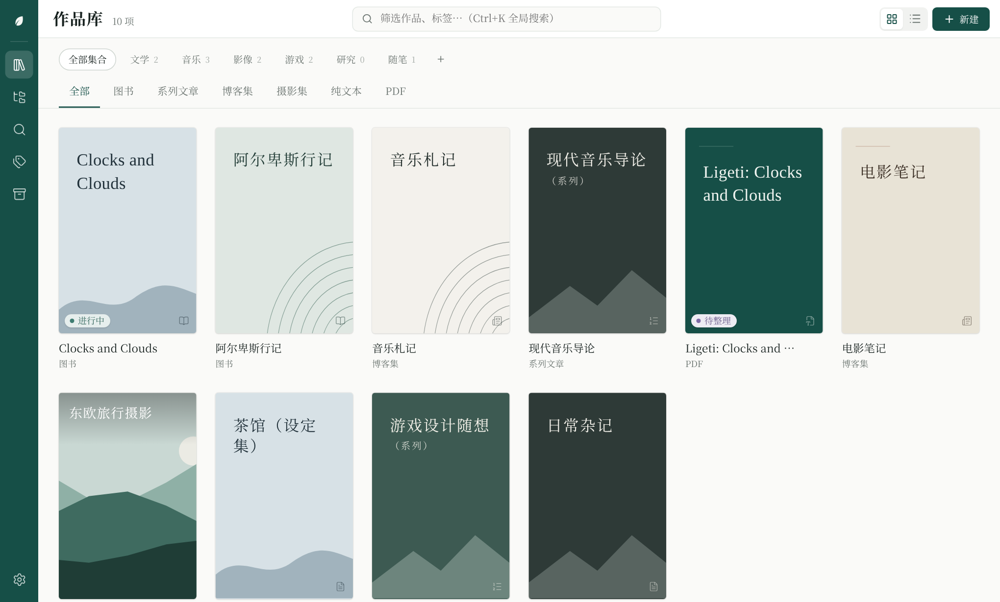
*作品庫：左側圖示列、集合標籤、類型分頁與封面*

---

## 3. 集合與作品

### 3.1 基本概念

- **集合**是一組作品，例如「文學作品」或「攝影作品」，可以混合放入任何類型。
- **作品**（畫面上稱為 单品）是一件完整的創作：書籍、系列文章、部落格、攝影集、純文字文件或典藏的 PDF。
- 作品裡的組成部分——章節、文章、照片——統稱為**內容單元**。

### 3.2 新增內容

按作品庫右上角的 **＋ 新建**（新增）：

- **新建集合**——新增集合。
- **图书 / 系列文章 / 博客集 / 摄影集 / 纯文本**（書籍／系列文章／部落格／攝影集／純文字）——新增作品。若上方已選定某個集合，就會放進該集合；否則 Leafor 會詢問要放在哪裡。
- **导入 Markdown / Word（DOCX）/ 照片 / PDF（只读）**（匯入）——見第 12 節。

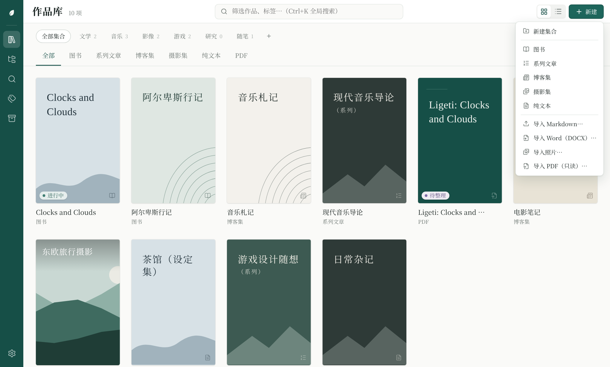
*「新建」選單：新增集合與作品，或匯入檔案*

也可以按集合標籤列最後面的 **＋** 新增集合。

### 3.3 瀏覽作品庫

- **集合標籤**（全部集合、文学…）依集合篩選；**類型分頁**（全部、图书、系列文章…）依類型篩選。
- 上方搜尋框可依標題、摘要、作者與標籤篩選；按 **Enter** 會進行完整搜尋。
- 用 **新建** 旁的兩個按鈕切換**格狀**與**清單**檢視。
- **調整作品順序：** 先選定單一集合（且不套用類型篩選），再拖曳封面。
- **多選：** 按住 **Ctrl** 點選多個封面，再使用出現的 **批量设置状态与标签**（批次設定狀態與標籤）。

### 3.4 作品選單

將滑鼠移到封面上按 **⋯**，或在封面上按右鍵：

| 選單項目 | 作用 |
| --- | --- |
| 打开 | 開啟作品。 |
| 重命名 | 修改標題（磁碟上的資料夾名稱維持不變）。 |
| 属性与封面 | 標題、作者、摘要、備註與封面圖片（**选择封面** 選擇封面／**使用默认封面** 使用預設封面）。 |
| 状态与标签 | 設定狀態與標籤。 |
| 移动到集合… | 移到其他集合。 |
| 在文件管理器中显示 | 在檔案總管中顯示作品資料夾。 |
| 归档 | 從作品庫隱藏但不刪除（可在「归档与回收站」找回）。 |
| 移到回收站 | 刪除（可復原，見第 13 節）。 |

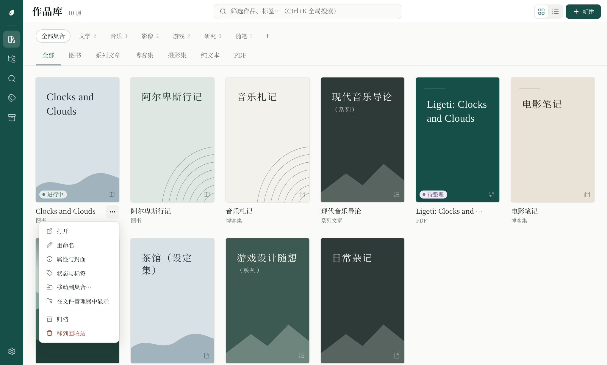
*作品選單（按封面上的 ⋯ 或按右鍵）*

沒有封面圖片的作品會自動產生平面的文字封面；攝影集則使用第一張照片作為封面。

---

## 4. 以 Markdown 寫作

書籍、部落格文章、系列文章與純文字文件都使用同一個編輯器。

### 4.1 檢視模式

| 模式 | 說明 |
| --- | --- |
| **编辑**（編輯） | 只顯示 Markdown 原始內容。 |
| **分屏**（分割畫面） | 左邊是原始內容，右邊是排版後的預覽。勾選 **同步滚动** 可讓兩邊同步捲動。 |
| **预览**（預覽） | 只顯示排版後的閱讀畫面。 |

切換模式絕不會更動你的檔案。

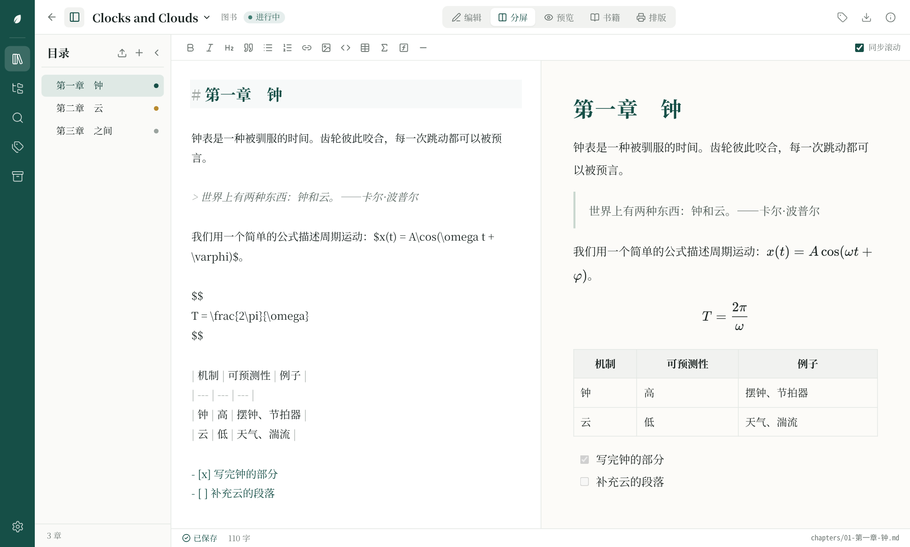
*分割畫面：左側為 Markdown 原始內容，右側為即時預覽；最左邊是目錄*

### 4.2 工具列與快速鍵

工具列可插入：粗體、斜體、標題、引言、項目／編號清單、連結、**圖片**、程式碼區塊、表格、行內公式、區塊公式與分隔線。

| 快速鍵 | 動作 |
| --- | --- |
| Ctrl+S | 立即儲存 |
| Ctrl+B / Ctrl+I | 粗體／斜體 |
| Ctrl+F | 在編輯器中尋找（與取代） |
| Ctrl+Z / Ctrl+Y | 復原／重做 |
| Tab | 縮排 |

### 4.3 支援的 Markdown

標準 Markdown，另外支援表格、工作清單（`- [x]`）、刪除線、註腳（`[^1]`）、具語法醒目提示的程式碼區塊，以及**數學公式**：

```markdown
行內公式：$e^{i\pi} + 1 = 0$

區塊公式：
$$
\int_0^1 x^2\,dx = \frac{1}{3}
$$
```

無法辨識的語法會原封不動保留。

### 4.4 圖片

按工具列的**圖片**按鈕並選擇檔案，Leafor 會把圖片複製到作品的 `assets/` 資料夾並插入相對路徑連結。你的原始圖片不會被移動或修改。為了保護隱私，網路圖片（`https://…`）不會自動載入。

### 4.5 儲存、衝突與復原

- **自動儲存：** 停止打字約一秒後，檔案會以安全的方式寫入（先寫入暫存檔，再一次性取代）。狀態列會顯示 **已保存**（已儲存）、**未保存**（未儲存）或 **保存中…**（儲存中）。
- **外部修改：** 若你在 Leafor 開啟時用其他程式編輯了檔案，回到 Leafor 視窗時會自動重新載入。如果你這邊**也**有尚未儲存的修改，會出現 **文件冲突**（檔案衝突）對話框，並排顯示兩個版本；你可以把自己的版本另存為副本、捨棄，或覆寫。Leafor 絕不會在未告知的情況下覆寫檔案。
- **當機復原：** 尚未儲存的文字會保存為草稿。若程式意外關閉，下次開啟時會出現黃色提示列，可選擇 **恢复**（還原）或 **丢弃**（捨棄）。

---

## 5. 書籍（图书）

### 5.1 目錄（目录）

左側面板列出所有章節。若看不到，請按返回箭頭旁的 **◫**。

- **＋** 新增章節；**↑** 把 Markdown 檔案匯入為章節。
- **拖曳**章節即可調整順序，會出現一條線標示放置位置。
- 在章節上**按右鍵**可重新命名、設定狀態／標籤、複製、匯出或刪除。
- 拖曳面板右邊緣可調整寬度（在邊緣按兩下恢復預設）。

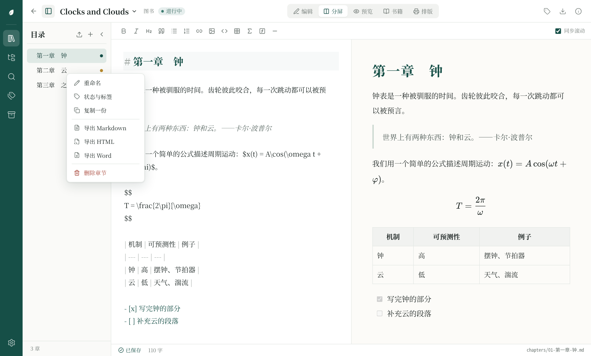
*在章節上按右鍵開啟選單*

每個章節都是書籍 `chapters/` 資料夾中的一個獨立 `.md` 檔案。

### 5.2 書籍閱讀模式（书籍）

以平面頁面呈現整本書，可選單頁或跨頁。

| 操作 | 動作 |
| --- | --- |
| ← → ／ Page Up、Page Down ／ 空白鍵 | 翻頁 |
| Home ／ End | 第一頁／最後一頁 |
| 點選目錄中的章節 | 跳到該章 |
| **Aa** 按鈕 | 字級、行距、紙張顏色 |
| 書本按鈕 | 切換單頁／跨頁 |
| 搜尋按鈕 | 在整本書中尋找文字 |
| 下方滑桿 | 跳到任意位置 |

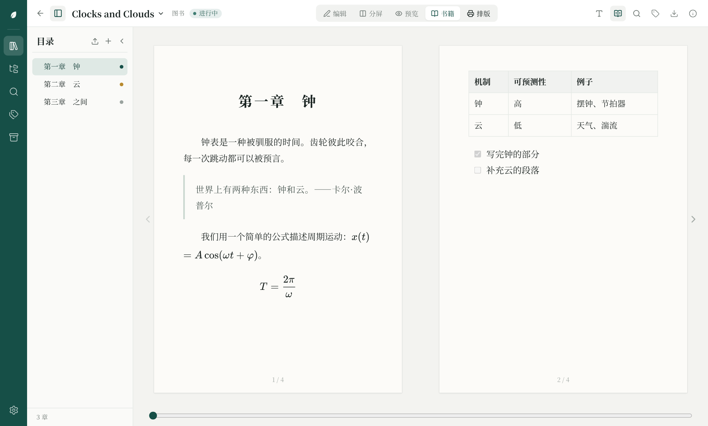
*跨頁顯示的書籍閱讀模式*

### 5.3 排版與 PDF（排版）

把書籍製作成可印刷的 PDF：

1. 選擇一個**预设**（預設：A5 文学书、32 开小说、B5 讲义、A4 文稿），或自行調整：
   - **纸张与版心**（紙張與版心）——開本（A4／B5／A5／32 開／自訂）、方向、邊界（裝訂用的內側／外側）。
   - **字体与段落**（字型與段落）——字型（預設為宋體／明體）、字級、行距、首行縮排、段距。
   - **章节与书籍元素**（章節與書籍元素）——每章從新頁／奇數頁開始、章名對齊、封面、書名頁、含頁碼的目錄。
   - **页眉页脚**（頁首頁尾）——頁碼（置中或外側）、頁首顯示章名、左右頁對稱、自訂頁首／頁尾文字。
   - **输出**（輸出）——解析度：150 dpi（快速）、200 dpi（螢幕閱讀）、300 dpi（列印）。
2. 按 **生成成品预览**（產生成品預覽），逐頁檢查結果。
3. 若要修改，請編輯章節內容或調整設定後重新產生；PDF 本身不會被編輯。
4. 按 **导出 PDF**（匯出 PDF）。匯出的檔案與你剛才預覽的完全相同。

排版設定可用 **保存配置**（儲存設定）隨書保存（`layouts/print.json`）。注意：PDF 頁面是高解析度影像，因此無法在 PDF 中選取文字。

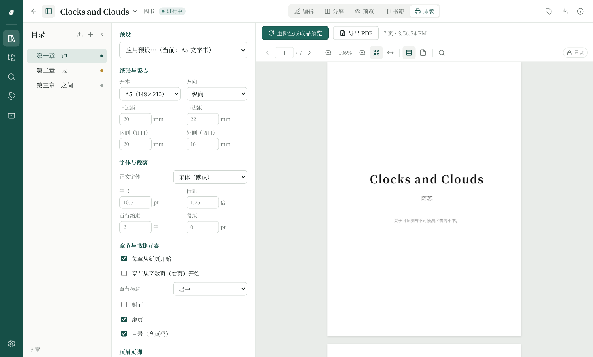
*左側為排版設定，右側為產生的 PDF 預覽*

---

## 6. 部落格（博客集）

- **博客首页**（部落格首頁）依日期由新到舊列出文章，**草稿**另外分區顯示。
- 側邊面板依**年 → 月**分組。點月份可篩選；點標籤可依標籤篩選；小搜尋框可搜尋本部落格。
- **沒有發佈日期的文章就是草稿。** 在文章上方的資訊列中：
  - 設定**日期**，或按 **今天发布**（今天發佈）／**转为草稿**（轉為草稿）；
  - 填寫一句**摘要**，會顯示在部落格首頁；
  - 設定 **slug**，用於匯出時的檔名。
- 狀態（例如 待校对／待校對）與發佈日期彼此獨立。
- 閱讀模式下，文章底部有前一篇／後一篇的連結。
- 在部落格首頁勾選多篇文章，可批次修改狀態與標籤。

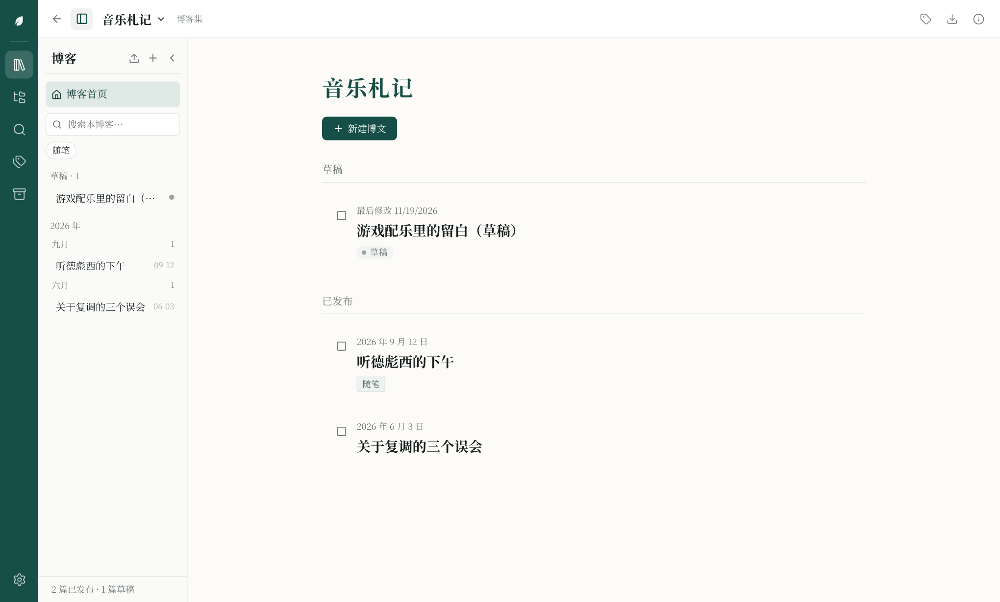
*部落格首頁：草稿、依日期排列的文章，以及年／月彙整*

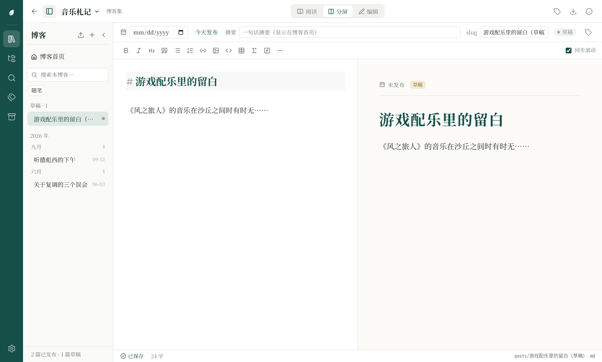
*編輯文章：編輯器上方可設定發佈日期、摘要與 slug*

---

## 7. 系列文章

- 閱讀順序就是**你安排的順序**，與建立日期無關——在 **系列目录**（系列目錄）面板中拖曳文章即可調整。
- **分組**（分卷／分部）：按「資料夾＋」圖示新增分組，再把文章拖進去。在分組上按右鍵可重新命名、上移／下移或刪除（其中的文章會變成未分組，不會被刪除）。
- 閱讀畫面會顯示系列名稱、分組，以及 **第 n / N 篇**，並附有 **上一篇／下一篇** 連結。
- **连续阅读**（連續閱讀）會在同一頁中顯示整個系列。
- 系列首頁有 **从第一篇开始阅读**（從第一篇開始閱讀）。

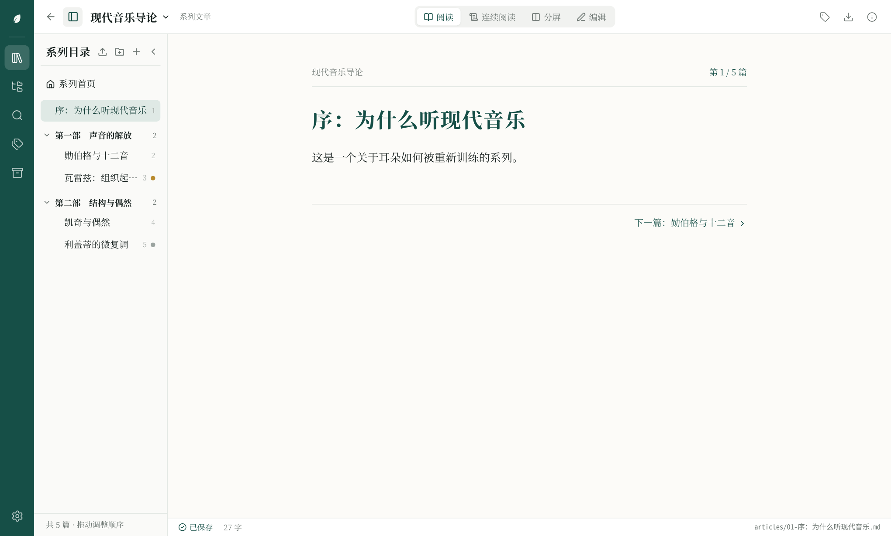
*閱讀系列文章：目前位置、目錄中的分組，以及上一篇／下一篇連結*

---

## 8. 攝影集（摄影集）

- **导入照片**（匯入照片）會把照片複製到攝影集中（原始檔案不受影響），並讀取尺寸與相機的 EXIF 資訊。
- **拖曳**縮圖可調整順序；用滑桿調整縮圖大小。
- **點選**照片開啟檢視器：← → 瀏覽、**F** 全螢幕、**I** 資訊面板、**Esc** 關閉。
- 在資訊面板中可編輯標題、說明、備註、狀態與標籤，並查看 EXIF 資料。
- 可用 **待P图**（待修圖）等狀態追蹤修圖進度。Leafor 沒有內建修圖功能：請用 **用系统程序打开**（以系統程式開啟）在你慣用的軟體中修圖，再按 **替换为修图后的版本**（換成修圖後的版本）換上新檔案（舊檔會移到資源回收筒）。
- 側邊面板可依狀態或標籤篩選。按住 **Ctrl** 點選多張照片，可批次修改標記或移到資源回收筒。
- 在照片上按右鍵 → **设为封面**（設為封面），即可設定攝影集封面。

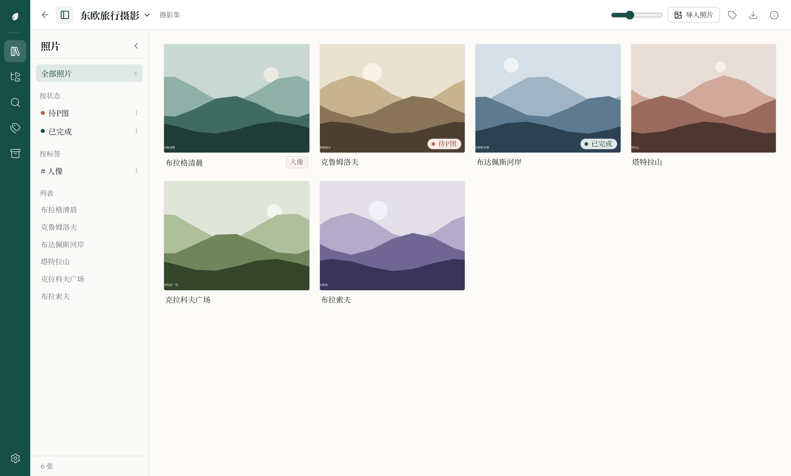
*顯示狀態標記與篩選器的攝影集*

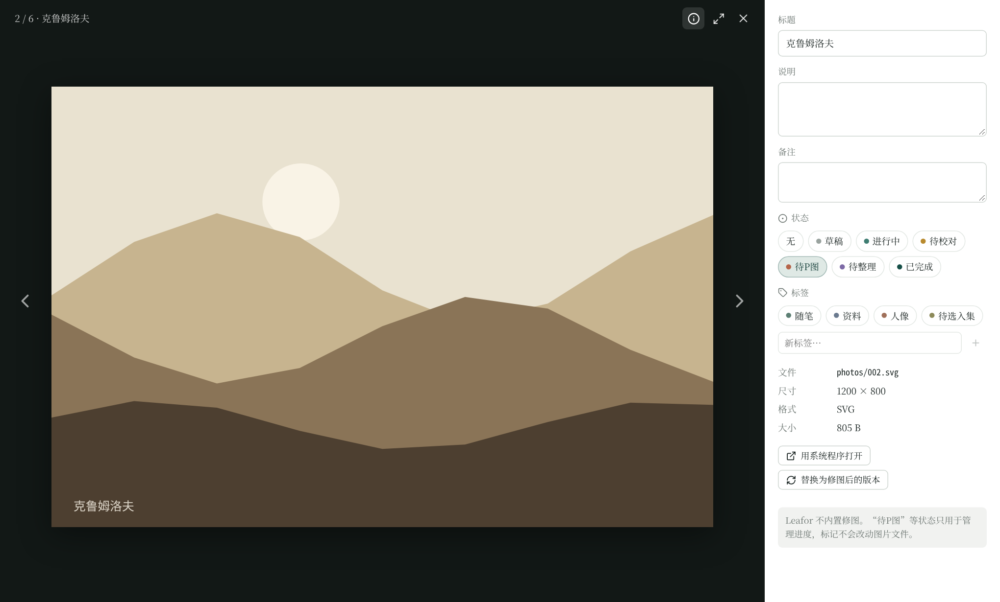
*開啟資訊面板的照片檢視器*

---

## 9. 典藏 PDF（唯讀）

匯入的 PDF 是典藏物件：**Leafor 絕不修改它們。**

- 可翻頁、縮放（符合頁面／符合寬度／百分比）、連續或單頁檢視（單頁模式用 ← → 翻頁），並可搜尋文字（**Ctrl+F**，需 PDF 含文字層）。
- 側邊面板有三個分頁：**書籤**（PDF 本身的大綱）、**縮圖**與**備註**（由 Leafor 保存，不寫入 PDF）。
- 標籤、狀態、備註與上次閱讀位置都保存在 Leafor 的詮釋資料中。
- **🛡 校驗**會把檔案的 SHA-256 指紋與匯入時記錄的值比對。
- **外部開啟**會以預設的 PDF 閱讀器開啟；**另存原始 PDF** 會把完全相同的副本存到其他位置。
- 加密的 PDF 會要求輸入密碼，密碼只用於檢視，不會被儲存。

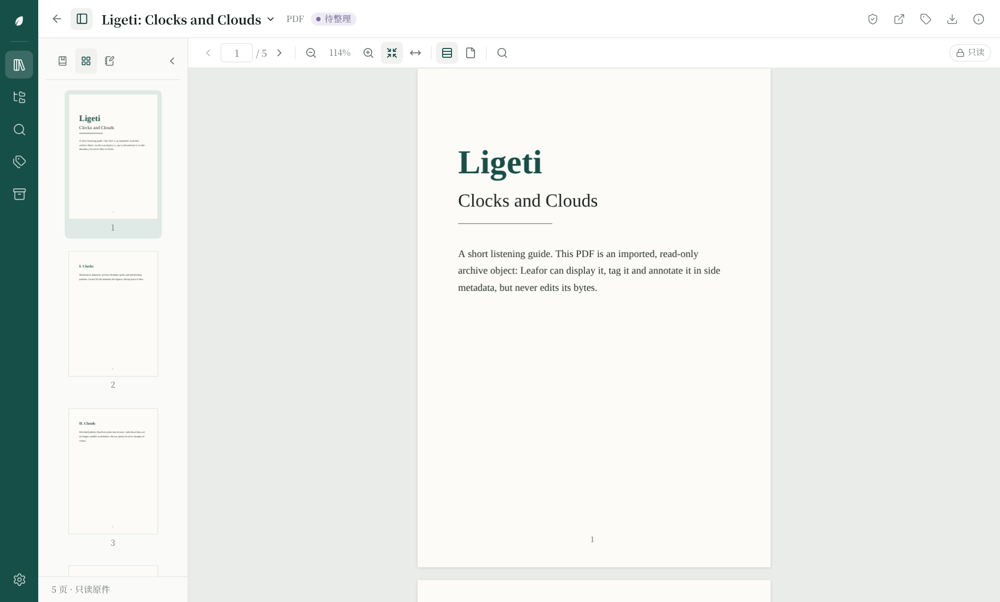
*典藏 PDF：附書籤、縮圖與備註的唯讀閱讀器*

---

## 10. 純文字文件（纯文本）

單一 Markdown 文件，側邊有依標題自動產生的 **大纲**（大綱）面板，點標題即可跳轉。

---

## 11. 標籤、狀態與搜尋

### 11.1 標籤與狀態的差別

- **狀態（状态）** 代表進度。每個對象一個：草稿、进行中、待校对、待P图、待整理、已完成——也可以自訂。
- **標籤（标签）** 是自由分類，每個對象可以有多個：随笔、资料、人像、待选入集…
- 作品本身與其中每個章節／照片／文章的標記**彼此獨立**。

可以用作品頂端列的**標籤按鈕**設定，也可以在任何章節／文章／照片上按右鍵設定，或多選後批次設定。在彈出視窗中也能直接輸入**新標籤**並按 Enter。

在 **标签与状态** 頁面可以重新命名、更換顏色、調整順序與刪除；點使用次數即可搜尋所有使用該標記的項目。

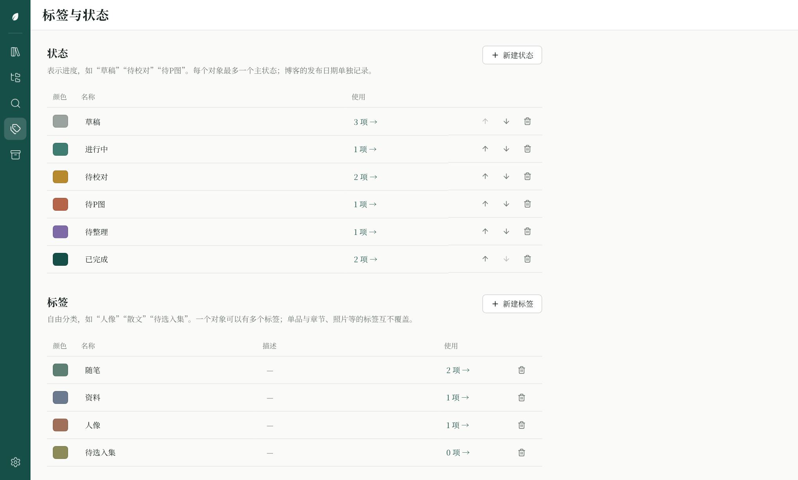
*「标签与状态」頁面*

### 11.2 搜尋（Ctrl+K）

可搜尋標題、所有 Markdown 的全文、照片說明、備註與標籤名稱（支援中文子字串比對）。可依狀態、標籤、類型、集合篩選，並選擇只看作品、只看內容單元或兩者皆看。例如：選擇狀態 **待P图**，就能列出所有攝影集中仍待修圖的照片。

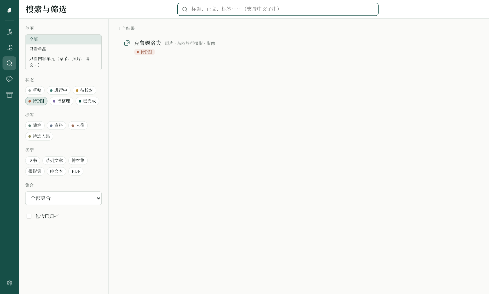
*依狀態「待P图」篩選的搜尋結果*

---

## 12. 匯入與匯出

### 12.1 匯入

| 來源 | 方式 | 結果 |
| --- | --- | --- |
| Markdown | 新建 → 导入 Markdown | 每個檔案成為一份純文字文件，或把多個檔案合併成一本書（每個檔案一章）。相對路徑的圖片會一併複製。 |
| Markdown 匯入到既有作品 | 書籍／部落格／系列面板中的 ↑ 按鈕 | 新增章節／文章。 |
| Word（.docx） | 新建 → 导入 Word | 可依標題層級拆分成章節（可在對話框中修改章名），或保留為單一文件。圖片放入 `assets/`，原始 .docx 保存在 `originals/`。公式與註解可能無法完整轉換。 |
| 照片 | 新建 → 导入照片，或攝影集中的 导入照片 | 複製到攝影集。 |
| PDF | 新建 → 导入 PDF（只读） | 原封不動複製到 `originals/` 並記錄指紋。 |

所有匯入都是**複製**，你的來源檔案絕不會被修改。

### 12.2 匯出（頂端列的 ↓ 按鈕，或在內容單元上按右鍵）

| 作品類型 | 格式 |
| --- | --- |
| 書籍 | Markdown（每章一檔或合併）、HTML、Word、PDF（透過 排版） |
| 部落格 | 單篇（MD／HTML／Word）；整個部落格匯出為離線 HTML 彙整（可選是否含草稿）；Markdown |
| 系列文章 | 單篇；合併的 Markdown；含目錄與前後篇連結的 HTML 網站；單頁 HTML；Word；PDF |
| 純文字 | Markdown、HTML、Word、PDF |
| 攝影集 | 原始照片檔（全部或所選） |
| PDF | 與原檔完全相同的副本 |

匯出的 HTML 可離線使用：圖片與數學字型都會一併放進匯出資料夾。匯出成 Word 時，公式會以 LaTeX 文字保留。

---

## 13. 刪除、封存與還原

- **封存（归档）：** 從作品庫隱藏，但檔案留在原位。可用 **取消归档** 取消封存。
- **移到資源回收筒（移到回收站）：** 作品、集合、章節／文章與照片都會移到作品庫內的 `.leafor/trash` 資料夾。
- 在 **归档与回收站** 頁面：**恢复**（還原）；**永久删除**（永久刪除）——這是唯一真正刪除檔案的動作。
- **刪除集合：** 前往 **集合**，按集合卡片上的 **⋯** → **移到回收站**。集合中的作品會一起移入。

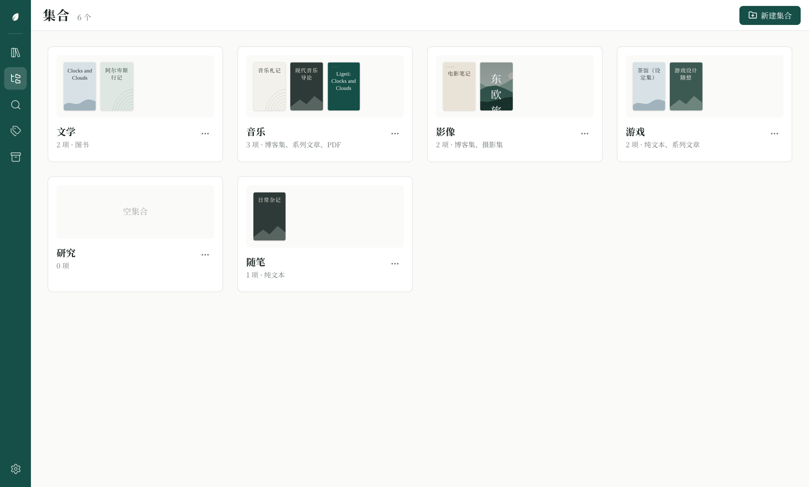
*「集合」頁面*

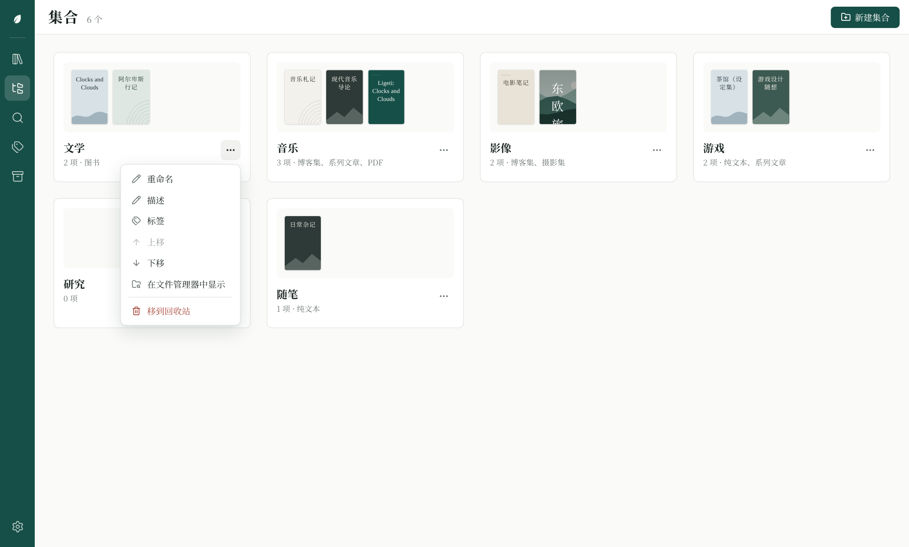
*集合的 ⋯ 選單——「移到回收站」即可刪除*

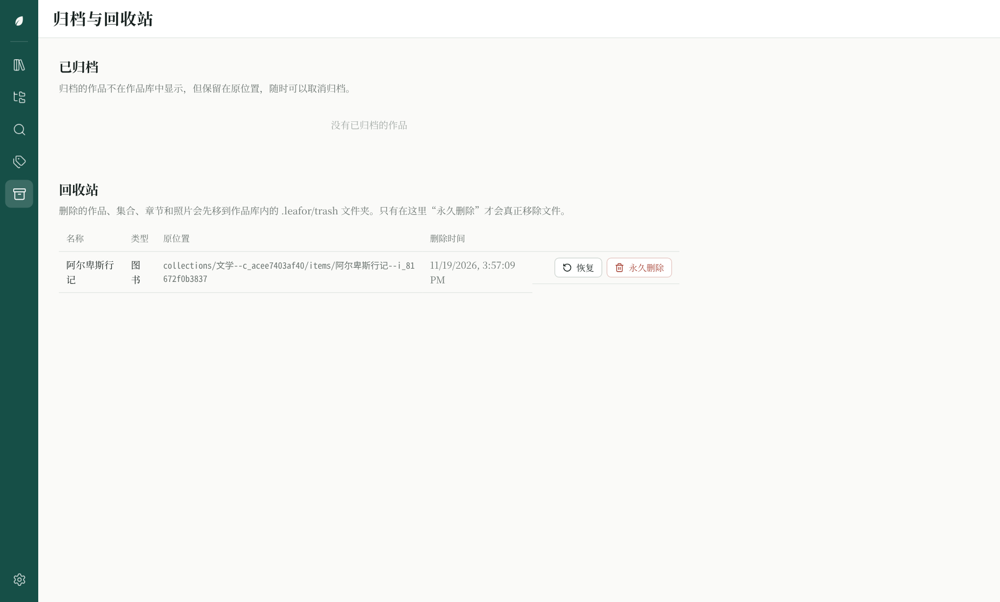
*「归档与回收站」：還原或永久刪除*

---

## 14. 檔案存放在哪裡

```text
我的作品庫/
├── .leafor/
│   ├── workspace.json      標籤、狀態、集合順序、設定
│   ├── cache/              縮圖與 PDF 預覽（可放心刪除）
│   ├── recovery/           尚未儲存的草稿
│   └── trash/              資源回收筒
└── collections/
    └── 文学--c_…/
        ├── collection.json
        └── items/
            └── 我的书--i_…/
                ├── item.json        標題、章節順序、標記…
                ├── chapters/*.md    你的文字
                ├── assets/          圖片
                ├── layouts/         PDF 排版設定
                └── originals/       匯入的原始檔（DOCX、PDF）
```

- **備份或搬移**作品庫，只要複製整個資料夾即可。內部使用相對路徑，放到哪裡都能用。
- 你可以用任何編輯器修改 `.md` 檔案，Leafor 會讀取這些變更。
- 搜尋索引與縮圖只是快取。在 **设置 → 重建搜索索引／清除缩略图与预览缓存** 可重新產生，不會影響你的作品。

---

## 15. 疑難排解

| 問題 | 解決方式 |
| --- | --- |
| 看不到章節目錄（目录） | 按 **←** 旁的 **◫**。視窗較窄時會自動隱藏。 |
| 找不到刪除的東西 | 到 **归档与回收站**，同時查看「已归档」與「回收站」。 |
| 文字沒有使用宋體／明體 | **设置 → 字体** 會列出偵測到的字型。安裝 SimSun 或思源宋體後重新啟動。 |
| 出現「文件冲突」對話框 | 檔案在你有未儲存修改時被外部程式改動。選擇要保留的版本；「把我的版本另存為副本」最安全。 |
| 出現黃色的復原提示列 | Leafor 找到上次未儲存的文字，請選擇 **恢复** 或 **丢弃**。 |
| 搜尋找不到最近的修改 | **设置 → 重建搜索索引**。 |
| 載入時有檔案被略過 | **设置** 會列出無效的詮釋資料檔，這些檔案在磁碟上都未被更動。 |
| HEIC／TIFF 照片無法顯示 | 檢視器無法顯示這些格式，請用 **用系统程序打开**。 |
| Leafor 無法啟動 | 確認 `WebView2Loader.dll` 與 `Leafor.exe` 在同一資料夾，並已安裝 WebView2 執行階段。 |

---

## 16. 快速鍵

| 位置 | 按鍵 | 動作 |
| --- | --- | --- |
| 任何地方 | Ctrl+K | 搜尋 |
| 編輯器 | Ctrl+S、Ctrl+B、Ctrl+I、Ctrl+F、Ctrl+Z／Ctrl+Y、Tab | 儲存、粗體、斜體、尋找、復原／重做、縮排 |
| 書籍閱讀 | ← →、Page Up／Down、空白鍵、Home、End | 翻頁、第一頁／最後一頁 |
| 照片檢視器 | ← →、F、I、Esc | 瀏覽、全螢幕、資訊、關閉 |
| PDF 閱讀器 | Ctrl+F；單頁模式下 ← → | 搜尋、翻頁 |
| 對話框與選單 | Enter、Esc | 確認、關閉 |
